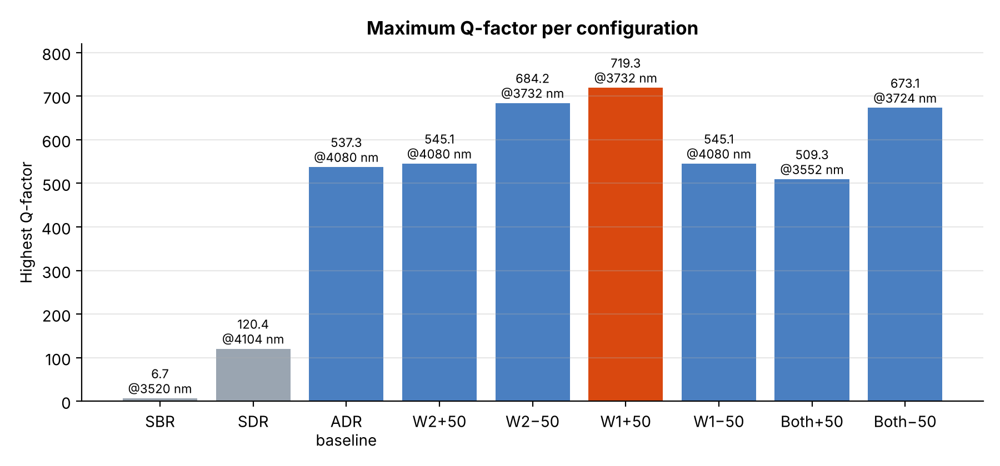
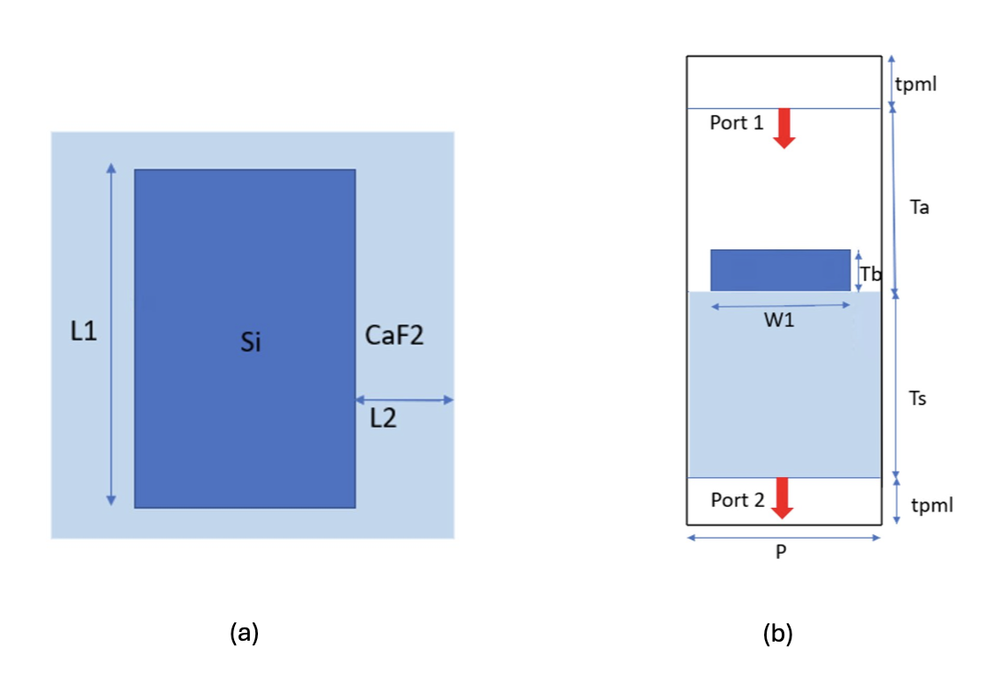
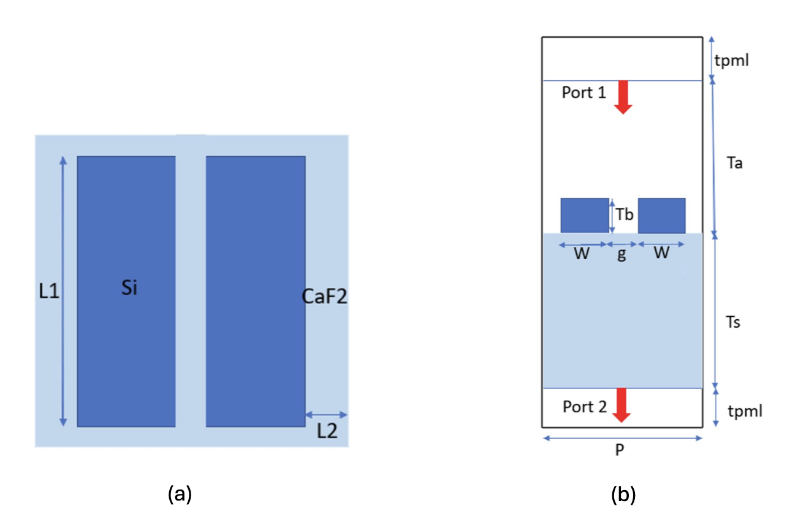
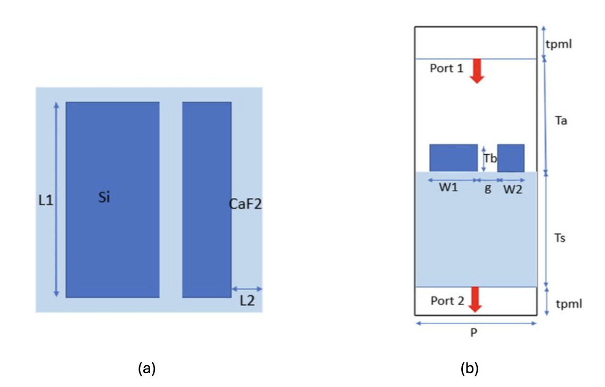
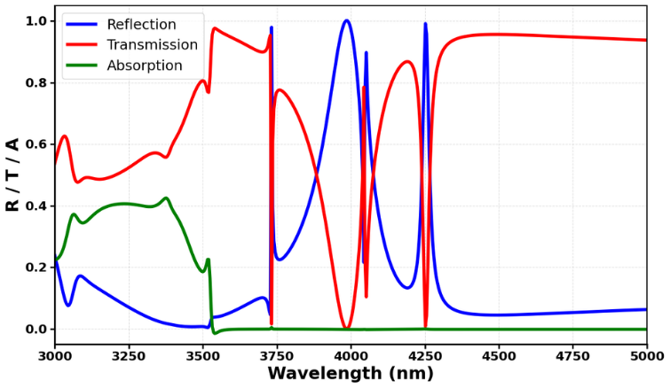
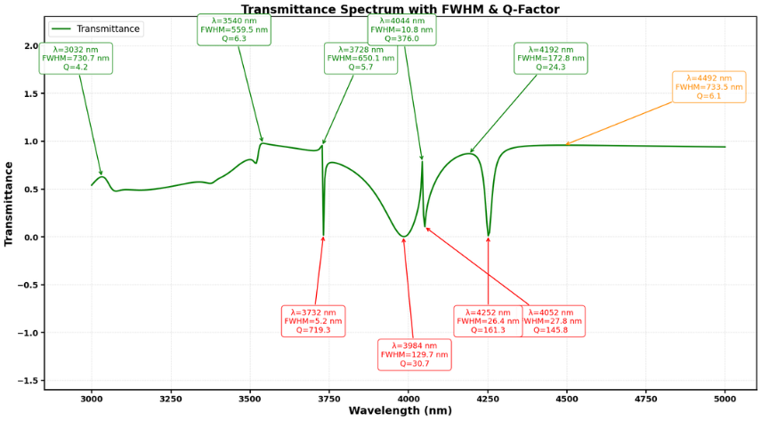

# High-Q Silicon Dual-Bar Metasurfaces for Mid-IR Filtering & Sensing

Full-wave **COMSOL Multiphysics** design and analysis of all-dielectric **silicon nanobar metasurfaces on CaF₂** in the **mid-infrared (3000–5000 nm)**. Moving from a single bar, to a symmetric pair, to an **asymmetric dual-bar resonator**, then tuning bar widths in ±50 nm steps, raises the Q-factor from **6.7 to 719.3**.

> M.Tech Project (MTP), RF & Microwave Engineering, **IIT Kharagpur**
> Supervisor: **Prof. Shailendra Kumar Varshney**, Dept. of E&ECE

---

## Highlights

- **3 resonator families:** Single Bar (SBR) → Symmetric Dual-Bar (SDR) → Asymmetric Dual-Bar (ADR).
- **7 ADR geometries** from a **±50 nm parametric sweep** of the bar widths W₁ and W₂.
- **Maximum Q-factor 719.3 at 3732 nm** (FWHM ≈ 5.2 nm), with the larger bar widened to **W₁ = 1.10 µm**. That is **~107×** the single bar.
- **E- and H-field maps** at every key resonance show:
  - **gap-confined E-fields**
  - **H-field localization that moves between the bars**: the smaller bar dominates at short λ, the larger bar at long λ
- **Losses:** absorption is about 0, so incident power splits between R and T (Si and CaF₂ are low-loss in the mid-IR).



Full per-structure spectra, Q-factor plots and field maps are in **[RESULTS.md](RESULTS.md)**.

---

## Why This Matters

The **mid-IR (3–5 µm)** is the *molecular fingerprint region*, where many gases and biomolecules absorb. Sensors and narrow-band filters there need **high-Q resonances**.

- **Plasmonic metasurfaces** suffer ohmic loss, which limits Q to about 10 or less.
- **All-dielectric (Si) metasurfaces** avoid that loss. Breaking the structure's symmetry turns an ideal **bound state in the continuum (BIC)** into a **quasi-BIC** with a very sharp, measurable resonance.

This project maps, using **simple and fabrication-friendly bar geometries**, how small changes to the asymmetry control:
- the resonance wavelength
- the Q-factor
- where the electric and magnetic fields are localized

---

## Simulation Setup

| Parameter | Value |
|-----------|-------|
| Solver | COMSOL Multiphysics, frequency domain, 3D unit cell |
| Resonators | Silicon bars, height **Tb = 700 nm**, length **L₁ = 2.0 µm** |
| Substrate | CaF₂, **Ts = 4 µm** |
| Superstrate | Air, Ta = 4 µm |
| Period | **P = 2.5 µm** |
| Inter-bar gap | **g = 150 nm** (all dual-bar designs) |
| Boundaries | Periodic sidewalls · 1 µm PML top and bottom |
| Excitation | Port 1 (top, incident + reflection) → Port 2 (bottom, transmission) |
| Sweep | 3000–5000 nm |

```
R = |S11|²        T = |S21|²        A = 1 − (R + T)        Q = λ0 / FWHM
```

| SBR | SDR | ADR (baseline) |
|:---:|:---:|:---:|
|  |  |  |
| W = 1.6 µm | W = 0.8 µm × 2 | W₁ = 1.05 µm, W₂ = 0.55 µm |

---

## Results Summary

| Configuration | W₁ (µm) | W₂ (µm) | λ₀ (nm) | Highest Q |
|---------------|:------:|:------:|--------:|----------:|
| Single Bar (SBR) | 1.6 | – | 3520 | 6.7 |
| Symmetric Dual-Bar (SDR) | 0.80 | 0.80 | 4104 | 120.4 |
| ADR baseline | 1.05 | 0.55 | 4080 | 537.3 |
| W₂ + 50 nm | 1.05 | 0.60 | 4080 | 545.1 |
| W₂ − 50 nm | 1.05 | 0.50 | 3732 | 684.2 |
| **W₁ + 50 nm** ⭐ | **1.10** | **0.55** | **3732** | **719.3** |
| W₁ − 50 nm | 1.00 | 0.55 | 4080 | 545.1 |
| Both + 50 nm | 1.10 | 0.60 | 3552 | 509.3 |
| Both − 50 nm | 1.00 | 0.50 | 3724 | 673.1 |

**Key findings**
1. **Symmetric coupling** across the 150 nm gap splits the broad single-bar dipole into sharper modes (Q: 6.7 → 120.4).
2. **Breaking the symmetry** (W₁ ≠ W₂) excites sub-radiant, quasi-BIC-like modes (Q > 500).
3. A **±50 nm change** in one bar width moves the high-Q resonance between about 3550 and 4080 nm and changes Q by up to about 35%.
4. **Field maps:**
   - Short-λ high-Q modes come from **gap E-field confinement plus H-field in the smaller bar**.
   - At **longer λ (≈4.2–4.4 µm)** the **larger bar takes over** as the dominant resonator.

| Best design: W₁ + 50 nm, R/T/A | Q-factor extraction |
|:---:|:---:|
|  |  |

---

## Repository Structure

```
high-q-silicon-metasurface/
├── README.md
├── RESULTS.md                    # every configuration: geometry, R/T/A, Q plot, E/H fields
├── figures/
│   ├── q_factor_summary.png
│   ├── 01_sbr/  02_sdr/  03_adr_baseline/
│   ├── 04_w2_plus50/  05_w2_minus50/
│   ├── 06_w1_plus50/  07_w1_minus50/
│   └── 08_both_plus50/  09_both_minus50/
└── scripts/
    └── q_factor.py               # find resonances, compute Q = λ0/FWHM, annotate plot
```

### Q-factor script

Export R/T/A vs wavelength from COMSOL as a CSV (`wavelength_nm, R, T, A`), then run:

```bash
pip install numpy pandas scipy matplotlib
python scripts/q_factor.py adr_w1_plus50.csv                 # dips in T
python scripts/q_factor.py adr_w1_plus50.csv --col R --peaks # peaks in R
```

The script prints λ₀, FWHM and Q for every resonance, sorted by Q, and saves an annotated plot.

---

## Future Work

- **Active tuning:** integrate a **graphene** layer and gate its Fermi level to switch the high-Q windows on and off.
- **Gas / RI sensing:** sweep the surrounding refractive index and compute **S = Δλ/Δn** and **FOM = S/FWHM**.
- **Slow light:** extract the group delay τg = −dφ/dω and the group index around the highest-Q windows.

---

## Key References

1. Y. Yang et al., "All-dielectric metasurface analogue of electromagnetically induced transparency," *Nature Communications*, 2014.
2. Y. Zhang et al., "High-quality-factor multiple Fano resonances for refractive index sensing," *Optics Letters*, 2018.
3. S. Zhang et al., "All-dielectric Si metamaterials with EIT and strong gap-mode electric field enhancement," *Optics Communications*, 2023.
4. E. N. Bulgakov et al., "Propagating bound states in the continuum in dielectric gratings," *JOSA B*, 2018.
5. J.-S. Li et al., "Triple frequency bands terahertz metasurface sensor based on EIT and BIC effects," *Optics Communications*, 2024.

---

## Author

**Queen Deori**, M.Tech, RF & Microwave Engineering, IIT Kharagpur
[GitHub](https://github.com/queendeori) · [LinkedIn](https://www.linkedin.com/in/queen-deori/)
